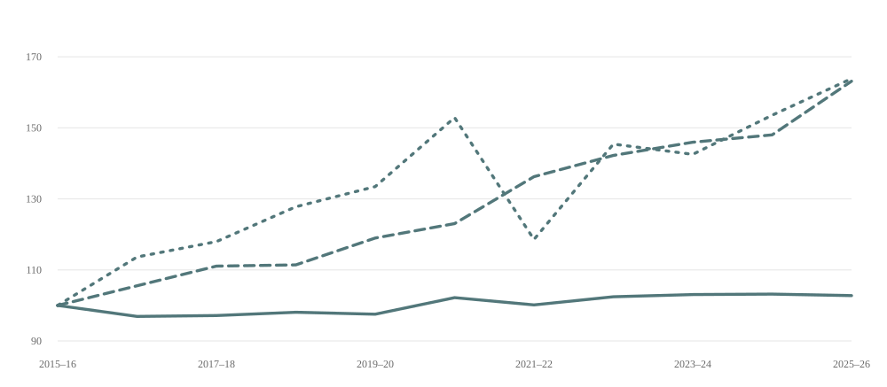

```{=html}
<div class="notes-page notes-article" lang="ca">
  <div class="notes-note-meta"><a href="../" aria-label="Tornar a Notes">Notes</a><span class="notes-issue"><span class="notes-bracket">[</span>001<span class="notes-bracket">]</span></span></div>
  <article>
    <h1>L’expansió desigual del sistema universitari català</h1>
    <p>En els darrers anys, el sistema universitari català ha experimentat transformacions importants que estan configurant un nou panorama de l'educació superior. Una d'aquestes transformacions és el creixement del nombre d'estudiants de nou accés a la universitat. <strong>Entre els cursos 2015-2016 i 2025-2026, el nombre d'estudiants de nou ingrés a grau ha augmentat un 20,5%,</strong> passant de 54.638 a 65.831 estudiants.</p>
    <p>Tanmateix, <strong>aquesta expansió no s'ha produït de manera homogènia</strong> entre els diferents tipus d'universitat.</p>
    <h2>Pèrdua del pes relatiu de la universitat pública</h2>
    <p>Mentre que <strong>les universitats públiques</strong> presencials han mantingut un volum de nou ingrés pràcticament estable, amb un increment del <strong>2,8%</strong>, <strong>les universitats privades presencials i les no presencials han experimentat creixements molt més intensos,</strong> <strong>superiors al 60%</strong> durant el mateix període.</p>
    <figure class="notes-figure">
      <figcaption class="notes-figure-title"><strong>Figura 1. Evolució dels estudiants de nou ingrés a grau segons tipus d'universitat. Catalunya, 2015-2016 a 2025-2026 (índex 2015-2016 = 100).</strong></figcaption>
      <div class="notes-chart-key" aria-label="Llegenda del gràfic"><span><i class="notes-keyline notes-pub" aria-hidden="true"></i> Públiques presencials</span><span><i class="notes-keyline notes-priv" aria-hidden="true"></i> Privades presencials</span><span><i class="notes-keyline notes-online" aria-hidden="true"></i> No presencials</span></div>
      <picture><source media="(max-width:650px)" srcset="../assets/figura-1-mobile.svg" /></picture>
      <p class="notes-source"><em>Font: Sistema Integrat d'Informació Universitària (SIIU). Elaboració pròpia. Estudiants de nou ingrés a grau en universitats de Catalunya, cursos 2015-2016 a 2025-2026. Darrer curs provisional</em></p>
    </figure>
    <p>L'evolució prenent com a base 100 el curs 2015-2016 permet comparar els ritmes de creixement dels tres blocs, independentment del volum inicial d'estudiants. <strong>Les universitats públiques presencials continuen concentrant el major nombre de nous ingressos, però són les que han experimentat un creixement més reduït.</strong></p>
    <p>Aquesta expansió desigual ha comportat <strong>una transformació de la composició del sistema d’educació superior</strong>. El curs 2015-2016, les universitats públiques presencials concentraven el 70,9% del nou ingrés a grau; deu cursos després, aquest percentatge se situa en el 60,4%. Paral·lelament, les privades presencials han passat del 10,8% al 14,7%, i les universitats no presencials, del 18,3% al 24,9%.</p>
    <h2>Més enllà del creixement: les desigualtats d’accés</h2>
    <p>Aquest canvi no és menor. <strong>La transformació de la composició institucional del sistema universitari planteja interrogants sobre les oportunitats d'accés i</strong> <strong>la distribució dels diferents perfils d'estudiants entre universitats</strong>.</p>
    <p>Les institucions universitàries no només es diferencien per la titularitat o la modalitat d'ensenyament. També poden acollir estudiants amb característiques sociodemogràfiques, trajectòries educatives i condicions de vida diferents. L'edat, les vies d'accés, l'origen social o la necessitat de compaginar els estudis amb el treball poden incidir en les oportunitats i les estratègies d'accés a l'educació superior. A més, les condicions de progressió, graduació i inserció laboral poden ser diferents segons els estudis i les institucions.</p>
    <p>En aquest sentit, l'expansió de les universitats privades i no presencials i la pèrdua de pes relatiu de les públiques presencials plantegen una qüestió que no podem resoldre únicament amb les dades agregades de nou ingrés: <strong>fins a quin punt aquesta transformació institucional està ampliant les oportunitats educatives o està generant noves formes de diferenciació i desigualtat dins del sistema universitari?</strong></p>
    <p>Per abordar aquesta qüestió no n'hi ha prou amb observar quants estudiants accedeixen a la universitat. També cal conèixer qui hi accedeix, quines són les seves característiques i condicions de vida i a quin tipus d’institucions accedeixen. Tot i això, actualment <strong>no disposem d'informació sistemàtica, homogènia i comparable sobre l'origen social familiar</strong> que cobreixi adequadament les universitats privades presencials i les no presencials.</p>
    <p>Aquesta manca d'informació afecta precisament els segments universitaris que més han crescut durant la darrera dècada i <strong>limita greument la capacitat d'analitzar l'equitat en l'accés al conjunt del sistema.</strong> Podem descriure com està canviant la composició institucional del sistema, però difícilment podem analitzar si aquesta expansió està contribuint a reduir, mantenir o ampliar les desigualtats socials en l'accés a la universitat.</p>
  </article>
  <div class="notes-article-bottom"><a href="../">← Totes les notes</a><span>001 / Notes</span></div>
</div>
```
