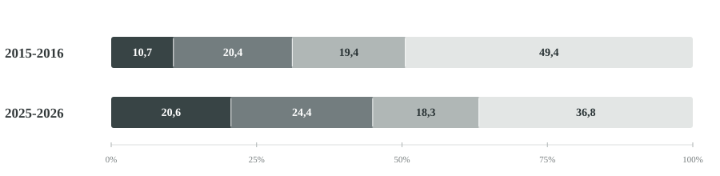

```{=html}
<div class="notes-page notes-article" lang="ca">
  <div class="notes-note-meta"><a href="../" aria-label="Tornar a Notes">Notes</a><span class="notes-issue"><span class="notes-bracket">[</span>002<span class="notes-bracket">]</span></span></div>
  <article>
    <h1>El nou accés a la universitat en línia: entre l'expansió i la diversificació</h1>
    <p><strong><a href="../001-expansio-desigual/" class="notes-inline-link">L'expansió del sistema universitari català s'ha produït de manera desigual</a></strong> entre els diferents tipus d'universitat. Un dels segments que més ha crescut és el de les universitats no presencials, que han experimentat <strong>un increment del 63,8% dels estudiants de nou ingrés a grau entre els cursos 2015-2016 i 2025-2026</strong>.</p>
    <p>Més enllà d'aquest increment, cal preguntar-se si <strong>el creixement de la universitat no presencial també està transformant el perfil dels estudiants i les seves formes d'accés a l'educació superior.</strong></p>
    <h2>Una modalitat que incorpora estudiants més joves</h2>
    <p>L'educació universitària no presencial s'ha associat tradicionalment a persones adultes que volen reprendre els estudis o adquirir nous coneixements mentre compaginen la formació amb altres responsabilitats, com el treball o les obligacions familiars. La flexibilitat horària i la reducció dels desplaçaments poden facilitar l'accés a la universitat en moments vitals en què la disponibilitat de temps és limitada, com ara durant la maternitat o en altres situacions de cura.</p>
    <p>Tanmateix, algunes recerques han posat de manifest que l'alumnat de la universitat en línia no constitueix un grup homogeni. Un <a href="https://doi.org/10.19173/irrodl.v21i3.4784" class="notes-inline-link">estudi sobre els estudiants de la Universitat Oberta de Catalunya</a> (Sánchez-Gelabert, Valente i Duart, 2020) ja identificava una diversitat de perfils i motivacions, incloent-hi la presència d'estudiants més joves sense responsabilitats laborals o familiars.</p>
    <p>Les dades del Sistema Integrat d'Informació Universitària (SIIU) permeten observar com ha evolucionat el perfil d'edat dels estudiants de nou ingrés durant la darrera dècada. En concret, <strong>els estudiants de 18 a 21 anys han passat de representar el 10,7% dels nous ingressos a les universitats no presencials el curs 2015-2016 al 20,6% el 2025-2026.</strong> En canvi, el pes dels majors de 30 anys s'ha reduït del 49,4% al 36,8%.</p>
    <figure class="notes-figure">
      <figcaption class="notes-figure-title"><strong>Figura 1. Distribució per edat dels estudiants de nou ingrés a grau a les universitats no presencials. Catalunya, 2015-2016 i 2025-2026 (%).</strong></figcaption>
      <div class="notes-age-legend" aria-label="Llegenda del gràfic"><span><i class="notes-age-swatch notes-age-18" aria-hidden="true"></i>De 18 a 21 anys</span><span><i class="notes-age-swatch notes-age-22" aria-hidden="true"></i>De 22 a 25 anys</span><span><i class="notes-age-swatch notes-age-26" aria-hidden="true"></i>De 26 a 30 anys</span><span><i class="notes-age-swatch notes-age-30" aria-hidden="true"></i>Més de 30 anys</span></div>
      <picture><source media="(max-width:650px)" srcset="../assets/figura-2-mobile.svg" /></picture>
      <p class="notes-source"><em>Font: Sistema Integrat d'Informació Universitària (SIIU). Elaboració pròpia. Estudiants de nou ingrés a grau en universitats no presencials de Catalunya. Curs 2025-2026 provisional.</em></p>
    </figure>
    <p>El canvi no afecta només els més joves. Els estudiants de 22 a 25 anys també augmenten el seu pes, mentre que els de 26 a 30 anys es mantenen en proporcions similars. <strong>Aquest rejoveniment no significa, però, una disminució del nombre d'estudiants adults.</strong> Els nous ingressos de més de 30 anys han augmentat de 4.949 a 6.032 durant el mateix període. Per tant, més que una substitució dels estudiants adults pels més joves, les dades mostren una diversificació del perfil d'edat en un context d'expansió de la modalitat no presencial.</p>
    <h2>Més enllà de l'edat: canvien les trajectòries d'accés?</h2>
    <p>Tot i aquest rejoveniment, les diferències entre modalitats continuen sent importants. <strong>La universitat no presencial manté un perfil d'edat més divers que la presencial, però incorpora una proporció creixent d'estudiants joves.</strong> Aquesta tendència, a més, ja era visible abans de la pandèmia: el curs 2019-2020, els estudiants de 18 a 21 anys ja representaven el 14,9% del nou ingrés no presencial.</p>
    <p>Aquests resultats plantegen nous interrogants sobre les formes d'accés a l'educació superior. Una qüestió especialment rellevant és <strong>si la universitat en línia està esdevenint una alternativa cada vegada més habitual per als joves que accedeixen a l'educació superior en les primeres etapes de les seves trajectòries educatives</strong>, més enllà del seu paper tradicional com a opció per reprendre estudis o compaginar-los amb altres responsabilitats.</p>
    <p>Tanmateix, <strong>l'edat constitueix només una primera aproximació a aquesta transformació.</strong> Per comprendre fins a quin punt estan canviant les trajectòries d'accés, caldria conèixer també les vies d'accés, els estudis previs, la situació laboral, les responsabilitats de cura i l'origen social dels nous estudiants.</p>
    <p>L'anàlisi d'aquests factors permetria anar més enllà dels canvis en la composició per edats i examinar <strong>si la diversificació del perfil d'estudiants està ampliant les oportunitats d'accés a la universitat o està configurant noves formes de diferenciació dins del sistema universitari.</strong></p>
  </article>
  <div class="notes-article-bottom"><a href="../">← Totes les notes</a><span>002 / Notes</span></div>
</div>
```
