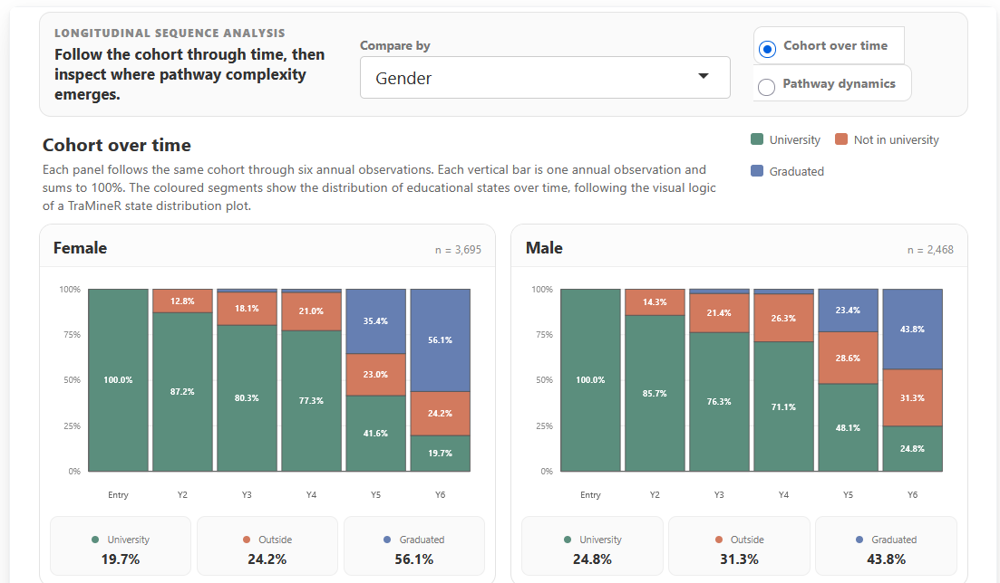
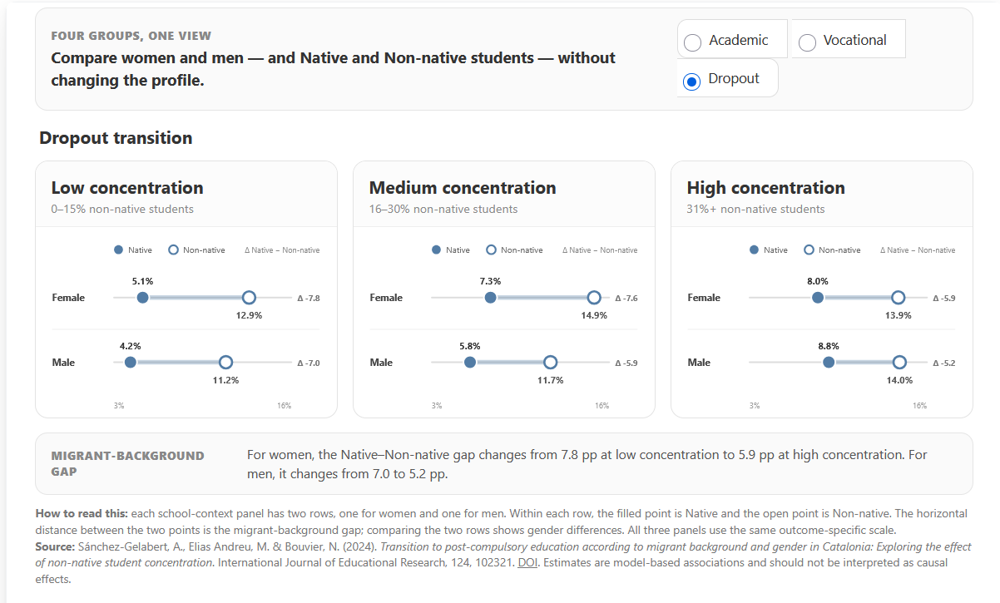
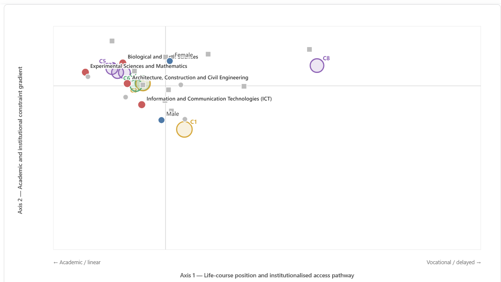
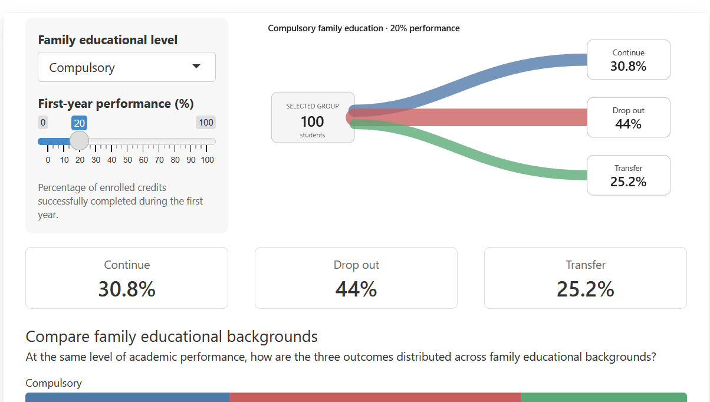
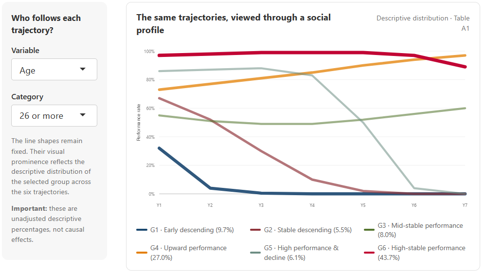

<style>
.tools-list {
  max-width: 980px;
  margin: 1.5rem auto 0 auto;
}

.tool-item {
  display: grid;
  grid-template-columns: 280px 1fr;
  gap: 1.6rem;
  align-items: start;
  padding: 1.4rem 0;
  border-bottom: 1px solid #e6e6e6;
}

.tool-item:first-child {
  padding-top: 0;
}

.tool-image-link {
  display: block;
  text-decoration: none;
}

.tool-image {
  width: 100%;
  aspect-ratio: 16 / 10;
  object-fit: cover;
  border-radius: 4px;
  border: 1px solid #e5e5e5;
  background: #f4f4f4;
}

.tool-content h3 {
  margin: 0 0 .45rem 0;
  font-size: 1.25rem;
  line-height: 1.25;
}

.tool-content h3 a {
  color: inherit;
  text-decoration: none;
}

.tool-content h3 a:hover {
  text-decoration: underline;
}

.tool-description {
  margin: 0 0 .65rem 0;
  line-height: 1.55;
}

.tool-meta {
  font-size: .82rem;
  color: #777;
  margin-bottom: .55rem;
}

.tool-link {
  font-size: .9rem;
  font-weight: 600;
  text-decoration: none;
}

.tools-note {
  margin-top: 1.4rem;
  font-size: .82rem;
  color: #777;
  line-height: 1.5;
}

@media (max-width: 720px) {
  .tool-item {
    grid-template-columns: 1fr;
    gap: .9rem;
  }

  .tool-image {
    max-height: 260px;
  }
}

/* Featured editorial Lab: intentionally distinct from exploratory tools. */
.eil-feature {
  max-width: 980px;
  margin: 1.6rem auto 2.5rem;
  padding: clamp(1.45rem, 3.5vw, 2.3rem);
  display: grid;
  grid-template-columns: minmax(0, 1.6fr) minmax(190px, .7fr);
  gap: clamp(1.2rem, 3vw, 2.6rem);
  background: linear-gradient(120deg, #f0f7f3 0%, #f5f6ef 100%);
  border: 1px solid #d7e5db;
  border-radius: 16px;
}
.eil-feature-kicker,
.eil-feature-aside-label {
  display: block;
  color: #287b70;
  font-size: .73rem;
  font-weight: 700;
  letter-spacing: .11em;
  text-transform: uppercase;
}
.eil-feature h2 {
  margin: .7rem 0 .85rem;
  font-family: Georgia, 'Times New Roman', serif;
  font-size: clamp(2.1rem, 4vw, 3.05rem);
  font-weight: 400;
  line-height: 1.08;
  letter-spacing: -.035em;
  color: #17323a;
}
.eil-feature h2 em { color: #187c6d; font-weight: 400; }
.eil-feature-description {
  max-width: 580px;
  margin: 0 0 1.25rem;
  line-height: 1.58;
  color: #3f5155;
}
.eil-feature-link {
  display: inline-flex;
  gap: .6rem;
  align-items: center;
  padding: .66rem 1rem;
  border-radius: 7px;
  background: #167468;
  color: #fff !important;
  font-weight: 650;
  font-size: .92rem;
  text-decoration: none !important;
  transition: background .18s ease;
}
.eil-feature-link:hover, .eil-feature-link:focus-visible {
  background: #105a52;
}
.eil-feature-aside {
  border-left: 1px solid #d0ddd5;
  padding-left: clamp(1.1rem, 2.3vw, 1.65rem);
  align-self: center;
}
.eil-feature-aside p {
  margin: .5rem 0 0;
  line-height: 1.55;
  color: #586a69;
  font-size: .92rem;
}
.eil-tools-heading {
  max-width: 980px;
  margin: 0 auto .55rem;
  color: #26383e;
  font-size: 1.45rem;
}
.eil-tools-intro {
  max-width: 980px;
  margin: 0 auto 1.4rem;
  line-height: 1.55;
  color: #667477;
}
@media (max-width: 720px) {
  .eil-feature { grid-template-columns: 1fr; gap: 1.2rem; }
  .eil-feature-aside {
    border-left: 0;
    border-top: 1px solid #d0ddd5;
    padding: 1rem 0 0;
  }
  .eil-feature h2 { font-size: clamp(2rem, 9vw, 2.65rem); }
}
</style>

```{=html}
<section class="eil-feature" aria-labelledby="eil-feature-title">
  <div>
    <span class="eil-feature-kicker">Educational Inequality Lab · Guided stories</span>
    <h2 id="eil-feature-title">Beyond <em>merit.</em></h2>
    <p class="eil-feature-description">Five interactive sociological stories about how educational inequalities emerge and change: school contexts, student lives, family resources, academic trajectories and institutional flexibility.</p>
    <a class="eil-feature-link" href="educational-inequality-lab/">Explore the Lab <span aria-hidden="true">→</span></a>
  </div>
  <div class="eil-feature-aside">
    <span class="eil-feature-aside-label">A different way to explore the research</span>
    <p>Follow a guided discovery, one chapter at a time. For independent analysis and more detailed results, use the research tools below.</p>
  </div>
</section>
```

<h2 class="eil-tools-heading" id="individual-tools">Individual research tools</h2>
<p class="eil-tools-intro">Explore the underlying research through interactive data visualisations and models.</p>

<div class="tools-list">

<div class="tool-item">

<a class="tool-image-link" href="pathways/">

</a>

<div class="tool-content">

### [Longitudinal Pathway Dynamics](pathways/)

<p class="tool-description">
Follow how a university cohort evolves across six annual observations and compare longitudinal pathway dynamics across student profiles.
</p>

<p class="tool-meta">
Sequence analysis · TraMineR · longitudinal trajectories
</p>

[Open explorer →](pathways/){.tool-link}

</div>
</div>


<div class="tool-item">

<a class="tool-image-link" href="context/">

</a>

<div class="tool-content">

### [School Context & Transition Explorer](context/)

<p class="tool-description">
Compare academic, vocational and dropout transitions across different school-composition contexts, examining gender and migrant-background inequalities at a glance.
</p>

<p class="tool-meta">
Predicted probabilities · gender × migrant background × school composition
</p>

[Open explorer →](context/){.tool-link}

</div>
</div>


<div class="tool-item">

<a class="tool-image-link" href="entry-space/">

</a>

<div class="tool-content">

### [University Entry Space Explorer](entry-space/)

<p class="tool-description">
Navigate the multidimensional space of university entry and examine how student characteristics, entry profiles and degree subfields are positioned within it.
</p>

<p class="tool-meta">
Multiple Correspondence Analysis · profiles · degree subfields
</p>

[Open explorer →](entry-space/){.tool-link}

</div>
</div>


<div class="tool-item">

<a class="tool-image-link" href="compensatory/">

</a>

<div class="tool-content">

### [Compensatory Advantage Explorer](compensatory/)

<p class="tool-description">
Explore how first-year academic performance and family educational background are associated with the probability of continuing, transferring or dropping out of university.
</p>

<p class="tool-meta">
Predicted probabilities · social background × academic performance
</p>

[Open explorer →](compensatory/){.tool-link}

</div>
</div>


<div class="tool-item">

<a class="tool-image-link" href="trajectories/">

</a>

<div class="tool-content">

### [University Trajectory Lab](trajectories/)

<p class="tool-description">
Explore six patterns of academic progression over seven years, who is more often found in each trajectory, and how adjusted probabilities differ across fields of study.
</p>

<p class="tool-meta">
Group-Based Trajectory Modelling · longitudinal progression
</p>

[Open lab →](trajectories/){.tool-link}

</div>
</div>

<div class="tools-note">
These tools are based on published studies and research outputs. Where model-based estimates are shown, they should be interpreted as associations rather than causal effects.
</div>

</div>

